# SRM LabReserve

**Laboratory room and equipment booking system for SRM Institute of Science and Technology, Trichy.**
Students and research scholars request lab rooms, single lab systems and instruments. Lab coordinators review the requests. Every decision is recorded.

`React 19` · `Vite` · `Express 5` · `SQLite (built into Node 24)` · `48 automated tests`

> Academic prototype. It uses fictional demo accounts and demo data and is not an official SRM service.

## Contents

1. [Abstract](#1-abstract)
2. [Problem statement](#2-problem-statement)
3. [Objectives](#3-objectives)
4. [Scope](#4-scope)
5. [Users and roles](#5-users-and-roles)
6. [Use cases](#6-use-cases)
7. [Requirements](#7-requirements)
8. [System architecture](#8-system-architecture)
9. [Workflow](#9-workflow)
10. [Flow charts](#10-flow-charts)
11. [Data design](#11-data-design)
12. [Data flow diagrams](#12-data-flow-diagrams)
13. [Security design](#13-security-design)
14. [Testing](#14-testing)
15. [Run it locally](#15-run-it-locally)
16. [Screenshots](#16-screenshots)
17. [Limitations](#17-limitations)
18. [Future scope](#18-future-scope)
19. [Conclusion](#19-conclusion)
20. [Project documents](#20-project-documents)

---

## 1. Abstract

Booking a laboratory usually means phone calls, paper registers or chat messages. Nobody can see which lab is free, two groups can end up with the same room, and nobody can tell afterwards who approved what.

SRM LabReserve is a web application that puts the whole process in one place. A student picks a date and time and sees which rooms, and which individual systems in a computer lab, are free. They send a request with a reason. A lab coordinator approves or rejects it, and the system stores who did what, when and why. Clashes are stopped on the server, inside a database transaction, so two requests for the same slot cannot both succeed.

The campus inventory has 22 bookable spaces: six CS labs (70 systems each), the AR/VR lab (40 systems), the Mac lab (40 systems), and fourteen labs and workshops without numbered systems, including six biotechnology labs. Ten demo instruments can be booked as well.

## 2. Problem statement

| # | Problem today | What goes wrong |
|---|---|---|
| P1 | There is no single view of lab availability | Students arrive to find a lab already in use |
| P2 | Two groups can ask for the same lab at the same time | Double bookings and arguments |
| P3 | A whole lab is blocked for one student who needs one computer | Labs with 70 systems sit mostly empty |
| P4 | Approvals, rejections and cancellations are not recorded | No accountability and no history |
| P5 | Nobody knows how many students use the labs, or for what | Usage cannot be reported |

## 3. Objectives

1. Show room, system and equipment availability for any date and time.
2. Make a double booking impossible, even when two requests arrive at the same moment.
3. Let a student book a single system in a lab without blocking the rest of it.
4. Give coordinators a clear queue to approve or reject, with a required reason for rejections.
5. Keep a permanent audit trail for every booking.
6. Give each role only the data and actions it should have.
7. Report usage: bookings, reserved hours, student headcounts and project work, with CSV export.

## 4. Scope

| In scope | Out of scope |
|---|---|
| Login, registration, sessions, two roles | SRM single sign-on |
| 22 lab rooms and workshops, 10 demo instruments | Verified building numbers and room capacities |
| Same-day bookings of up to 8 hours, in IST | Recurring bookings and timetables |
| Per-system booking for 8 labs | Tracking physical machines or attendance |
| Approval, rejection, cancellation, audit history | Email or SMS notifications |
| Free-room finder, Save My Practical planner | Payment, billing |
| Reports and CSV export | Multi-campus use |

## 5. Users and roles

| Actor | Internal role | Can do |
|---|---|---|
| Visitor | none | Register an account, sign in |
| Student / researcher | `researcher` | Browse, request bookings, see and cancel **their own** bookings, run reports on their own data |
| Lab coordinator | `manager` | Everything a student can, plus approve, reject and cancel **any** booking, manage labs and inventory, see all bookings |
| System | none | Check conflicts, write the audit log, expire sessions |

Registration always creates a student. A user cannot make themselves a coordinator.

## 6. Use cases

### 6.1 Use case diagram

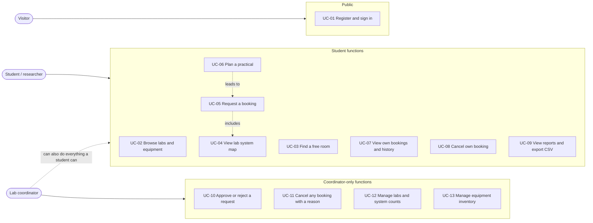

### 6.2 Use case descriptions

| ID | Use case | Actor | Main flow | Alternative / error flow |
|---|---|---|---|---|
| UC-01 | Register and sign in | Visitor | Enter name, email and a password of at least 10 characters. Then sign in. A session cookie is set. | Duplicate email gives 409. Wrong password gives 401. Ten failures lock sign-in for 15 minutes. |
| UC-02 | Browse labs and equipment | Student, Coordinator | Open Lab rooms or Equipment. Search and filter by category or status. | Maintenance and unavailable items cannot be booked. |
| UC-03 | Find a free room | Student | Choose date and time. The server lists free rooms and labs that still have free systems. | An invalid or past time shows an error. |
| UC-04 | View lab system map | Student | Open View systems on a lab. See which systems are available, booked or yours. Pick one. | A whole-lab booking or maintenance shows every system as unavailable. |
| UC-05 | Request a booking | Student | Choose resource, date, times, access type, headcount, purpose and reason. For individual access in a lab with systems, pick a system. Submit. The booking is **pending** and holds the slot. | Overlap gives 409. Bad input gives 400 with a message. |
| UC-06 | Plan a practical | Student | Enter activity, class size and time. Get ranked room and time options with reasons. Choose one to prefill a normal request. | No suitable room gives an explained empty result. |
| UC-07 | View own bookings | Student | Open My bookings. Filter, open details and the activity history. | A student cannot open another student's booking (403). |
| UC-08 | Cancel own booking | Student | Open the booking and cancel. The slot is released. | Finished bookings cannot be changed. |
| UC-09 | View reports and export CSV | Student, Coordinator | Filter by date, type, status, purpose and access type. Download the visible rows. | Only records the user may see are included. |
| UC-10 | Approve or reject | Coordinator | Open Approvals. Read the reason, requester and access details. Approve, or reject with a reason. | Approval repeats the conflict check and can return 409. |
| UC-11 | Cancel with a reason | Coordinator | Cancel any pending or approved booking. A reason is required and is shown to the student. | Missing reason gives 400. |
| UC-12 | Manage labs | Coordinator | Add or edit a lab. Set its status and its number of systems. | Cannot lower the system count below a system with an active booking (409). |
| UC-13 | Manage inventory | Coordinator | Add or edit instruments, quantity and status. | Invalid values give 400. |

## 7. Requirements

### 7.1 Functional requirements

| ID | Requirement |
|---|---|
| FR-01 | Users can register, sign in and sign out. Sessions expire after 8 hours. |
| FR-02 | The system shows availability for rooms, systems and equipment by date and time. |
| FR-03 | A booking request holds its time slot immediately as **pending**. |
| FR-04 | No two active bookings may overlap on the same resource. Back-to-back bookings are allowed. |
| FR-05 | Individual access in a lab with numbered systems books exactly one system. Group access books the whole lab. |
| FR-06 | Coordinators can approve a pending request, or reject it with a reason. |
| FR-07 | A booking can be cancelled. A coordinator must give a reason. |
| FR-08 | Every state change is stored with the actor, time and note, and is never deleted. |
| FR-09 | Students see only their own bookings. Coordinators see all. |
| FR-10 | Each booking records purpose category, reason, access type, headcount and, for project work, a project title. |
| FR-11 | Reports can be filtered and exported to CSV. |
| FR-12 | Coordinators can add and edit labs, set status, and set the number of systems. |
| FR-13 | The Save My Practical planner suggests ranked labs and times and never books on its own. |

### 7.2 Non-functional requirements

| ID | Area | Requirement |
|---|---|---|
| NFR-01 | Correctness | The conflict check and the write happen in one database transaction. |
| NFR-02 | Security | Passwords are hashed with scrypt and a random salt. Roles and ownership are checked on the server. |
| NFR-03 | Privacy | The system map and the shared availability feed never reveal who booked. |
| NFR-04 | Usability | Responsive layout down to phone width. Labelled forms, keyboard access, a skip link. |
| NFR-05 | Accessibility | Respects the reduced-motion setting. The Sign out button has a 44 px touch target. |
| NFR-06 | Portability | Needs only Node.js 24 or later. No database server. |
| NFR-07 | Maintainability | Automated tests run against a temporary database and never touch real data. |
| NFR-08 | Time | All lab dates and times use Asia/Kolkata (IST). Stored in UTC. |

## 8. System architecture

The browser runs a React single-page app. It talks to one Express server over same-origin REST requests with JSON. The server checks the session, the role and the input, then reads and writes SQLite. The same Express process also serves the built frontend, so there is one thing to start.

### 8.1 Architecture diagram

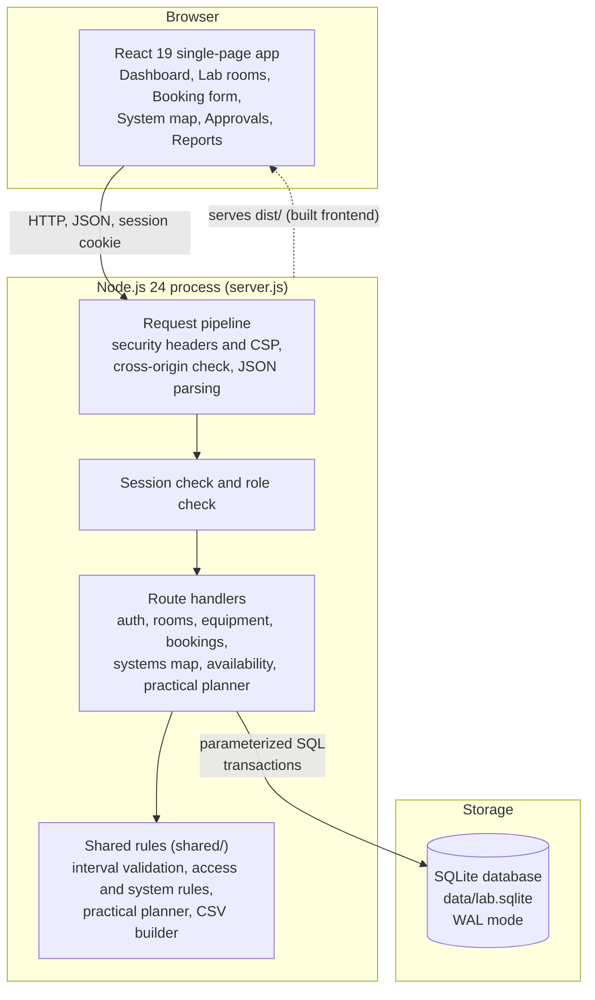

### 8.2 Technology stack

| Layer | Technology | Why |
|---|---|---|
| Frontend | React 19, Vite 7, lucide-react icons | Fast builds, component-based screens |
| Styling | Plain CSS, local DM Sans and Manrope fonts | No third-party requests; works offline |
| Backend | Node.js 24, Express 5 | Small and easy to read |
| Database | SQLite through Node's built-in `node:sqlite` | Real SQL, foreign keys and transactions with no server to install |
| Passwords | Node `crypto.scrypt` | Built in, slow by design |
| Tests | Node's built-in test runner | No extra tools |

### 8.3 Project structure

```text
booking/
├── server.js            Express API, database schema, migrations, seed data
├── shared/              Rules used by both the server and the browser
│   ├── booking.js       Interval validation, CSV export, purpose categories
│   ├── access.js        Access type, headcount, project title, system rules
│   └── practical.js     Save My Practical planner and demo lab profiles
├── src/                 React frontend
│   ├── main.jsx         App shell, pages, booking form, routing by URL hash
│   ├── Systems.jsx      System map, picker and "View systems" dialog
│   ├── AccessTracking.jsx, PresentationFeatures.jsx, SaveMyPractical.jsx, Footer.jsx
│   └── *.css            Styles (theme, motion, footer, systems, access)
├── tests/               48 automated tests (real HTTP, temporary database)
├── docs/                API, features, demo script, presentation, slide deck
├── presentation/        Isolated demo server and optional browser checks
├── public/              SRM logo
└── data/                lab.sqlite, created on first start (not in Git)
```

## 9. Workflow

### 9.1 Booking lifecycle

A booking is always in one of four states.

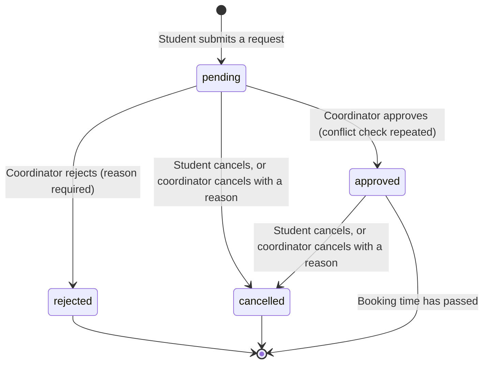

| State | Holds the slot? | Can change? |
|---|---|---|
| `pending` | Yes | Approve, reject or cancel, until its end time |
| `approved` | Yes | Cancel, until its end time |
| `rejected` | No | No. Make a new request instead |
| `cancelled` | No | No. The record stays in the history |

### 9.2 Request and approval sequence

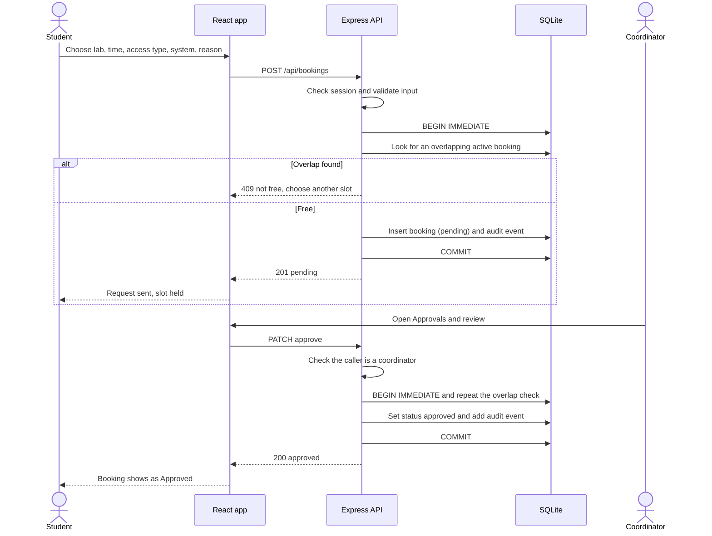

### 9.3 What a conflict means

The test is `new_start < existing_end AND new_end > existing_start`, applied to **pending and approved** bookings of the same room.

| New request | Conflicts with |
|---|---|
| Whole room, or equipment | Any active booking of that room, including single-system bookings |
| One system (for example system 12) | A whole-room booking, or another booking of system 12 |
| Starts exactly when another ends | Nothing. Back-to-back is allowed |

## 10. Flow charts

### 10.1 Creating a booking

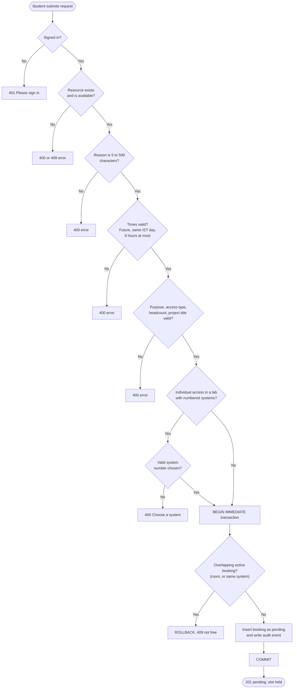

### 10.2 Coordinator decision

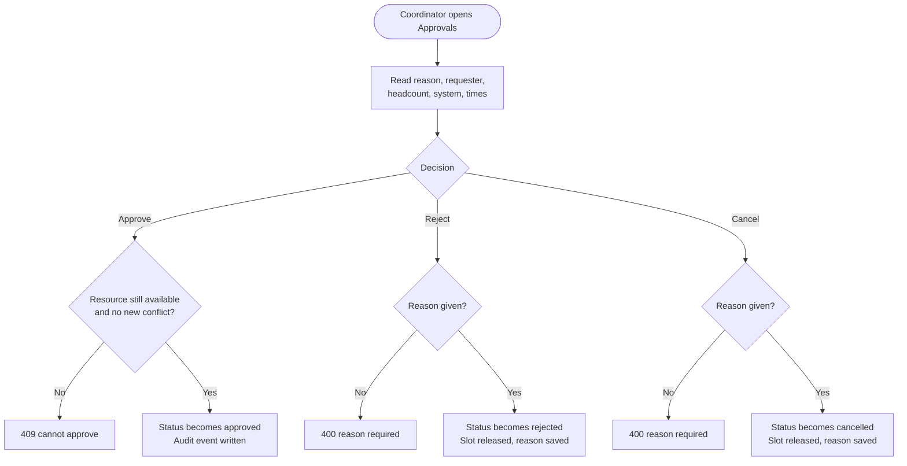

### 10.3 Choosing a system on the map

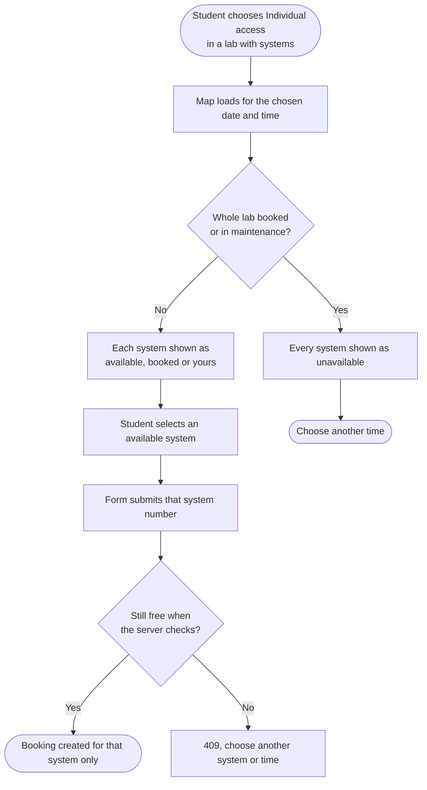

### 10.4 Save My Practical

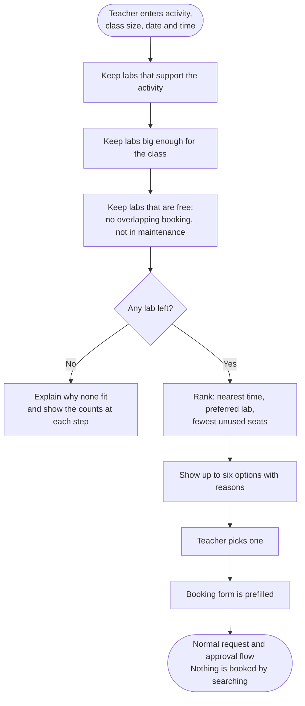

## 11. Data design

### 11.1 Entity relationship diagram

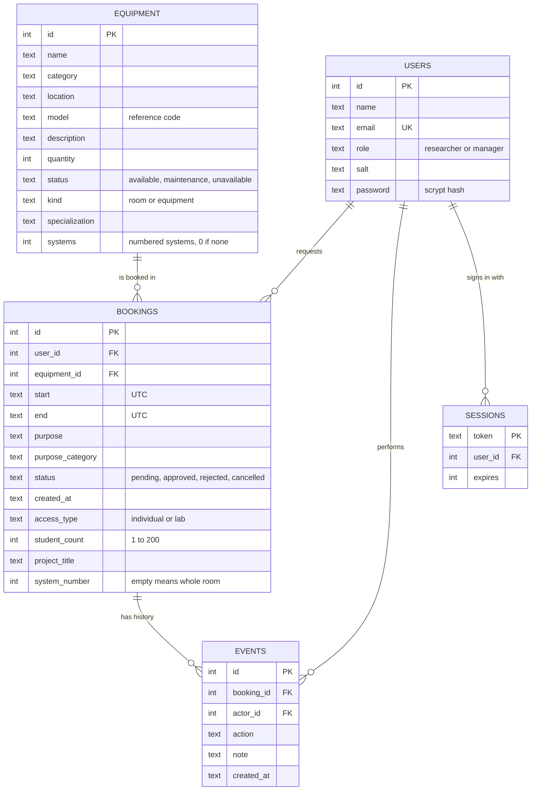

Rooms and instruments share the `equipment` table. The `kind` column tells them apart, so both use the same booking and audit engine. A `migrations` table records which one-time upgrades have run.

### 11.2 Data integrity

- Foreign keys are switched on. Statuses, roles and counts have `CHECK` constraints.
- `(equipment_id, status, start, end)` is indexed, because the conflict check runs on every request.
- Booking and event rows are never deleted by the API.
- Upgrades are additive and run once. Older bookings keep working, and show "Not recorded" where a newer field is empty.

## 12. Data flow diagrams

### 12.1 Level 0: context diagram

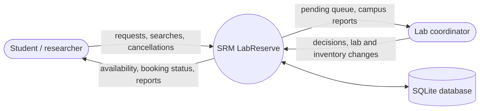

### 12.2 Level 1: main processes

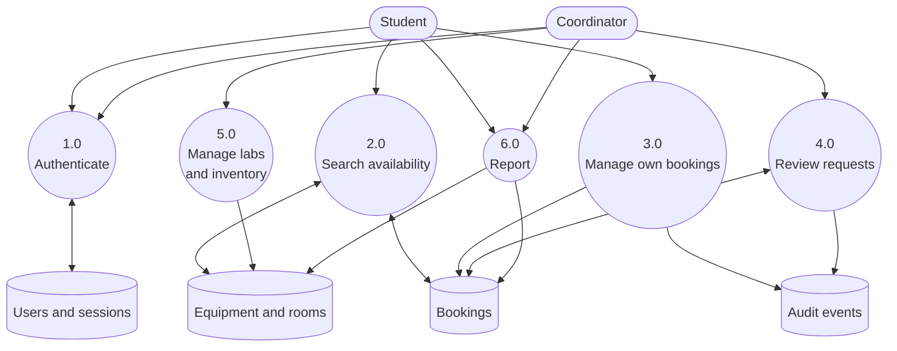

## 13. Security design

| Threat | Defence |
|---|---|
| Stolen password database | Passwords are stored only as scrypt hashes with a random salt per user. Comparison is timing-safe. |
| Guessing passwords | Ten failed sign-ins from one address locks sign-in for 15 minutes. |
| Session theft | Random 256-bit tokens in `HttpOnly`, `SameSite=Strict` cookies that expire after 8 hours. Optional `Secure` flag for HTTPS. |
| Cross-site requests | Writes from another origin are rejected. |
| Hiding a button is not security | Roles and booking ownership are enforced in the server, not only in the interface. |
| SQL injection | Every query with user data is parameterized. |
| Script injection | React escapes text. A strict content security policy blocks third-party scripts. |
| Spreadsheet formula injection | CSV export neutralizes cells that start with `=`, `+`, `-` or `@`. |
| Data leaks between students | Students get only their own bookings. The shared availability feed and the system map omit names and reasons. |
| Race conditions | The overlap check and the insert run inside `BEGIN IMMEDIATE`, and approval checks again. |

## 14. Testing

Run `npm test`. The 48 tests start a real HTTP server on a temporary database, sign in as different users and send real requests. Your `data/lab.sqlite` is never touched.

| Test file | What it checks |
|---|---|
| `api.test.js` | Registration, login, role protection, cross-origin blocking, overlaps and adjacency, invalid times, ownership, approval re-check, cancellation and history, simultaneous requests, privacy, logout, persistence after reopening the database |
| `rooms.test.js` | The exact 22-room inventory, required reasons, overlaps between rooms, coordinator-only management, maintenance protection, rejection and cancellation history |
| `presentation.test.js` | Biotechnology specializations, purpose categories, free-room finder, CSV formula safety, migration upgrades |
| `practical.test.js` | Planner ranking, ties, time shifting, honest empty results, input validation, no booking from a search |
| `access.test.js` | Individual and group access rules, headcount, project titles, summary arithmetic, CSV columns, migration, privacy |
| `systems.test.js` | System counts, one-time migration, same-system conflicts, whole-room blocking, system map statuses, privacy, finder, approval re-check, coordinator limits |

### Sample manual test cases

| ID | Steps | Expected result |
|---|---|---|
| TC-01 | Book CS Lab 1, 10:00 to 11:00. Request 10:30 to 11:30 | Second request fails with a clash message |
| TC-02 | Then request 11:00 to 12:00 | Succeeds, back-to-back is valid |
| TC-03 | Student A books system 12 and student B books system 12 for the same time | B is refused. B can take system 13 |
| TC-04 | Group-book CS Lab 2, then try to book one of its systems | Refused while the group booking is active |
| TC-05 | Coordinator rejects a request without a reason | Refused, reason required |
| TC-06 | Student opens another student's booking by its address | 403 forbidden |
| TC-07 | Sign out, then open a protected page | Sent to sign-in |
| TC-08 | Leave the app open past session expiry and click a button | Returns to sign-in with a message |
| TC-09 | Put a lab into maintenance | New requests and approvals are blocked |
| TC-10 | Export a CSV where a project title starts with `=` | The cell is prefixed so it is not run as a formula |

## 15. Run it locally

Needs Node.js **24 or later**. Nothing else is installed on the machine.

```bash
npm install
npm run build
npm start
```

Open **http://localhost:3000**. The first start creates `data/lab.sqlite` with three accounts, the 22 rooms and their system counts, ten demo instruments and a few example bookings. Later starts keep your data. After pulling new code, run `npm run build` again and restart the server, so that database upgrades run.

| Command | What it does |
|---|---|
| `npm start` | Runs the server on port 3000 (set `PORT` to change it) |
| `npm run build` | Builds the frontend into `dist/` |
| `npm run dev` | Frontend dev server with hot reload. Needs `npm start` running as well |
| `npm test` | Runs the 48 automated tests |
| `node presentation/demo-server.mjs` | In-memory demo with sample bookings on port 3001. Never edits your real data |

### Demo accounts

These accounts are fictional and exist only on your machine.

| Role | Email | Password |
|---|---|---|
| Student / researcher | `researcher@lab.test` | `LabDemo123!` |
| Lab coordinator | `manager@lab.test` | `LabDemo123!` |
| Second student | `sam@lab.test` | `LabDemo123!` |

Configuration: `PORT`, and `COOKIE_SECURE=1` when served over HTTPS (see `.env.example`). The server listens on the loopback address only.

## 16. Screenshots

Save My Practical, with demo data:

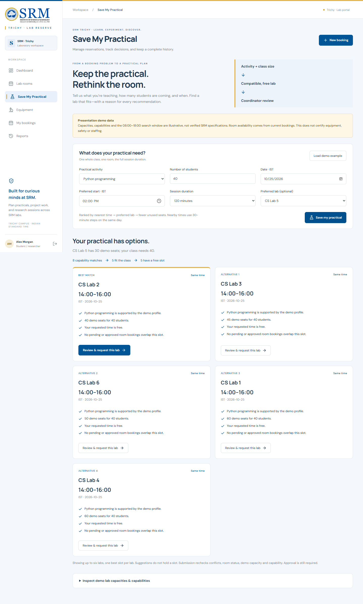

## 17. Limitations

- A local academic prototype with openly documented demo passwords. It is not a production SRM service and has no SRM single sign-on.
- Lab capacities for labs without numbered systems, and lab capabilities used by Save My Practical, are illustrative demo values. Building numbers and room assignments were not supplied and are not invented. Biotechnology specialization names are editable proposals.
- Bookings are same-day, start in the future and last at most eight hours.
- Student counts are headcounts entered by the requester. They are not rosters, and reserved hours are planned time, not measured attendance or use.
- Equipment is not linked to rooms, so booking a room does not block equipment in it.
- Approved bookings are not cancelled automatically when a lab goes into maintenance. A coordinator reviews them.
- A system number is a seat in the lab, not a tracked machine.
- SQLite and synchronous password hashing suit a small deployment, not a whole campus at once.

## 18. Future scope

1. Department-confirmed room details, capacities and equipment-to-room links.
2. SRM single sign-on and faculty accounts.
3. Email or SMS notifications for decisions and reminders.
4. Recurring bookings and class timetable import.
5. Check-in and check-out, so usage can be measured, not only planned.
6. A calendar view and a calendar file feed for approved bookings.
7. PostgreSQL, backups, monitoring and load testing for a wider rollout.

## 19. Conclusion

SRM LabReserve covers the whole booking cycle: see what is free, request with a reason, prevent clashes, approve or reject, cancel when needed, and keep the history. Letting one student book a single system in a 70-system lab, while the rest stays open, makes better use of the labs than blocking the whole room. The conflict rules are enforced in the database transaction, not just in the interface, and the 48 automated tests check them. The design leaves clear places to add real campus data and systems later.

## 20. Project documents

| Document | Contents |
|---|---|
| [docs/FEATURES.md](docs/FEATURES.md) | Detailed behaviour of every feature, including lab systems and access tracking |
| [docs/API.md](docs/API.md) | REST API reference and examples |
| [docs/DEMO.md](docs/DEMO.md) | Demo steps and the manual test checklist |
| [docs/PRESENTATION.md](docs/PRESENTATION.md) | Five-minute talk script and likely questions |
| [docs/SAVE-MY-PRACTICAL.md](docs/SAVE-MY-PRACTICAL.md) | Save My Practical walkthrough |
| [docs/SRM-LabReserve.pptx](docs/SRM-LabReserve.pptx) | Six-slide presentation deck |

Author: Harish V. The SRMIST logo in `public/srm-logo.svg` comes from the official SRMIST website and does not imply endorsement.
